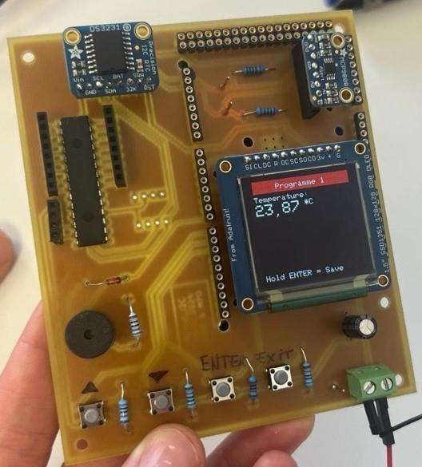
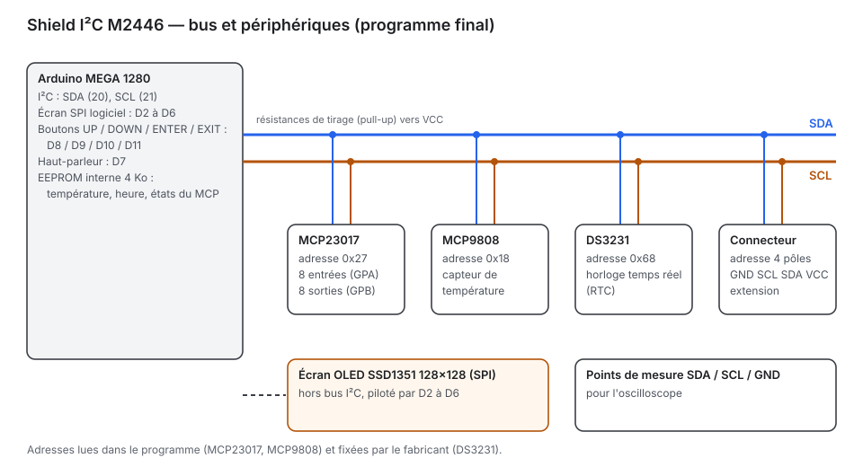
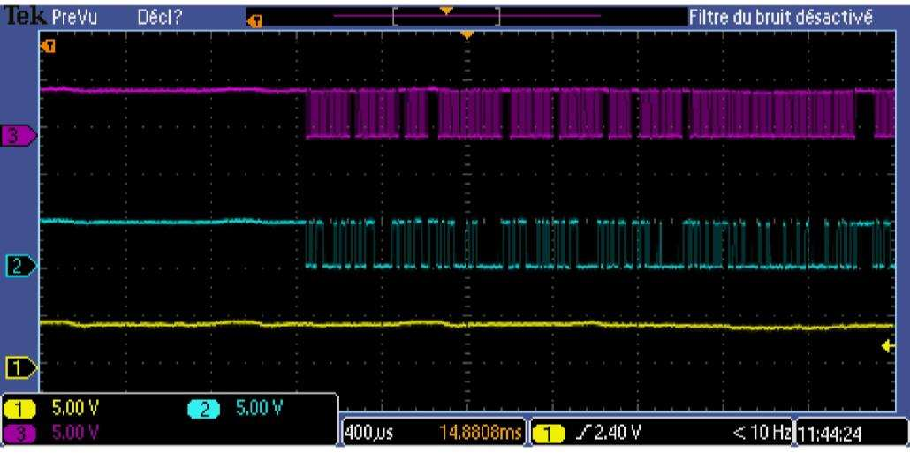

# Shield I²C pour Arduino MEGA (M2446)

Shield pour Arduino MEGA 1280 qui réunit plusieurs périphériques sur un même bus I²C : une extension d'entrées/sorties MCP23017, un capteur de température, une horloge temps réel et un connecteur d'extension. Un écran couleur et quatre boutons servent à naviguer dans un menu. Le programme scanne le bus en permanence et déclenche une alarme sonore si un esclave ne répond plus.

Projet du Module Complémentaire Technique (MCT) au CPNV, cours d'électronique, projet moyen M2446, réalisé de février à mars 2024 en binôme par Mattéo Pozzo di Borgo et Guilhem Rozier Vilardell. Mattéo a écrit le programme.

## Contenu du dépôt

| Dossier | Contenu |
|---|---|
| `firmware/Validation_Finale/` | Programme final, présenté à la validation du 7 mars 2024 |
| `firmware/etapes/` | Programmes intermédiaires dans l'ordre : tests de l'écran, de la température et de l'horloge, mise au point du menu, puis versions successives semaine après semaine |
| `docs/` | Étude « Ligne Data et Clock » (mesures à l'oscilloscope), schéma du bus, photos |

Les fichiers KiCad du circuit imprimé n'ont pas été conservés.

## Matériel et adresses

| Élément | Liaison | Adresse / broches |
|---|---|---|
| MCP23017, extension d'E/S (8 entrées GPA, 8 sorties GPB) | I²C | 0x27 |
| MCP9808, capteur de température | I²C | 0x18 |
| DS3231, horloge temps réel | I²C | 0x68 |
| Connecteur d'extension (GND, SCL, SDA, VCC) | I²C | — |
| Écran OLED couleur SSD1351, 128 × 128 | SPI logiciel | D2 à D6 |
| Boutons UP, DOWN, ENTER, EXIT | numérique | D8, D9, D10, D11 |
| Mini haut-parleur | numérique (`tone`) | D7 |

## Fonctionnement

Le menu propose six programmes. On les fait défiler avec UP et DOWN, on entre avec ENTER et on sort avec EXIT :

1. **Température** : affiche la mesure du MCP9808.
2. **Heure et date** : affiche l'heure de la RTC DS3231.
3. **Commande du MCP23017** : affiche les entrées GPA et allume ou éteint chaque sortie GPB avec ENTER.
4. **Mémoire** : enregistre puis relit la température, l'heure et l'état des broches GPA et GPB.
5. **Scanner I²C** : teste les adresses 1 à 126 et affiche celles qui répondent.
6. **Texte libre** : enregistre en mémoire un texte saisi depuis le moniteur série, puis le relit.

**Surveillance du bus.** Toutes les 500 ms, le programme rescanne les 126 adresses :
- s'il trouve moins de 3 esclaves, le haut-parleur sonne en alternant 800 Hz et 100 Hz ;
- si un périphérique apparaît, il émet un bip montant ; s'il disparaît, un bip descendant.

**Remise à zéro.** Pendant les 6 premières secondes après la mise sous tension, maintenir UP et DOWN plus de 2 s efface toute la mémoire (4 096 octets).

## Le bus I²C à l'oscilloscope

L'I²C n'utilise que deux lignes : SDA (données) et SCL (horloge). Toutes deux sont maintenues à l'état haut par des résistances de tirage. Le maître signale le début d'un échange (**start**) en faisant passer SDA à l'état bas pendant que SCL est haut. Il envoie ensuite l'adresse de l'esclave, puis les données ; chaque octet est suivi d'un bit d'acquittement. Il termine l'échange (**stop**) en remettant SDA à l'état haut pendant que SCL est haut. L'étude (`docs/Etude_I2C_Ligne_Data_Clock.pdf`) montre ces étapes sur des captures réelles.

### Temps d'un scan complet (calcul théorique)

Avec la fréquence I²C par défaut de l'Arduino, 100 kHz :

- durée d'un bit : 1 / 100 000 Hz = 10 µs ;
- test d'une adresse : start + 7 bits d'adresse + 1 bit lecture/écriture + 1 bit d'acquittement + stop, soit environ 11 temps de bit, donc 11 × 10 µs = 110 µs ;
- scan des 126 adresses : 126 × 110 µs = 13 860 µs ≈ 13,9 ms ;
- part du temps occupée par la surveillance, répétée toutes les 500 ms : 13,9 / 500 ≈ 0,028, soit environ 2,8 %.

Ce calcul ne compte que le temps des bits sur le bus. Le traitement de la bibliothèque `Wire` entre deux adresses allonge un peu le scan réel.

## Écarts par rapport à l'énoncé

| Énoncé | Programme final |
|---|---|
| Capteur de température TC74 | MCP9808 (les premières versions utilisaient le TC74) |
| Écran OLED (sur le bus I²C) | Écran SSD1351 en SPI, hors bus I²C |
| Mémoire externe 24LC01, 10 premières adresses réservées, remise à FFh | Mémoire EEPROM interne de l'Arduino, à d'autres adresses ; la remise à zéro écrit 0. L'en-tête du programme le précise : « toutes les composantes sauf la mémoire externe » |
| Alarme à 880 Hz pendant 3 s | Alarme alternant 800 Hz et 100 Hz tant que le bus est incomplet |

## Compiler

1. IDE Arduino, carte « Arduino Mega or Mega 2560 », processeur ATmega1280.
2. Bibliothèques à installer :
   - Adafruit MCP9808 ;
   - Adafruit GFX ;
   - Adafruit SSD1351 ;
   - DFRobot_MCP23017 ;
   - DS3231 (Andrew Wickert / NorthernWidget) ;
   - SparkFun External EEPROM.
3. Ouvrir `firmware/Validation_Finale/Validation_Finale.ino` et téléverser.
4. Pour régler l'heure de la RTC, utiliser `firmware/etapes/04_M2446_DS3231_setYMD-HMS`.

## Auteurs et licences

Mattéo Pozzo di Borgo (programme) et Guilhem Rozier Vilardell, MCT, CPNV, 2024.

- Code (`firmware/`) : licence MIT (voir [LICENSE](LICENSE)).
- Documents et images (`docs/`) : licence CC BY-NC-SA 4.0 (voir [LICENSE-CC-BY-NC-SA-4.0.md](LICENSE-CC-BY-NC-SA-4.0.md)).
